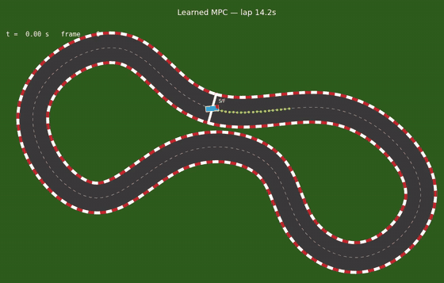

# py-allumette-optimize

[](https://github.com/Magikdidi24/py-allumette-optimize/actions/workflows/ci.yml)

Learning-based MPC for a small autonomous race car, written from scratch in
NumPy (EPITA SAE "Py-Allumette", 2025-26). No PyTorch in the controller: the
autodiff engine, the MLP, the optimizers and the MPC are all hand-written.



Full video: [`race_mlmpc.mp4`](race_mlmpc.mp4)

## What it does

- **Autodiff** (`student/autodiff/tensor.py`): reverse-mode autodiff on NumPy
  arrays (broadcasting, matmul, activations, trig, reductions, indexing,
  stacking). `tests/test_torch_compat.py` checks values and gradients against
  PyTorch.
- **MPC** (`student/mpc/`): at every 0.1 s step, Adam optimizes the next 15
  actions (throttle, steering) by back-propagating an MPCC-style cost
  (contouring + lag error, speed profile, soft track barrier, anti-spin terms)
  through a rollout of a dynamic bicycle model.
- **ML-MPC** (`student/ml/`, `student/mpc/controller.py`): a 3-layer MLP
  (8 → 64 → 64 → 6) trained on one noisy run of the nominal MPC predicts the
  one-step error of the nominal model. The controller then plans with
  `x_next = f_nominal(x, u) + dt * mlp(x, u)`.

The simulator moves the "real" car with the good parameters and RK45. The
controller's internal model uses Euler steps and, by default, the wrong
("bad") parameters; the MLP learns that gap.

## Results

One lap from the start line, lap time printed by `src/main_race.py`
(`steps x 0.1 s`). All four runs finish the lap without leaving the track.

| Controller | Internal model parameters | Lap time |
|------------|---------------------------|----------|
| Nominal MPC | bad (default) | 14.00 s |
| Learned MPC | bad (default) | 14.20 s |
| Nominal MPC | good | 14.00 s |
| Learned MPC | good | 14.40 s |

Measured with
`MPLBACKEND=Agg python src/main_race.py --impl student --mode {mpc,mlmpc} --parameters {bad,good}`
(Python 3.10, CPU; the race itself has no randomness). The learned MPC matches the
recorded video (`race_mlmpc.npy` holds 143 states, i.e. 142 steps = 14.2 s).
Both controllers chase the same reference speed profile, and here the learned
residual does not make the lap faster: the nominal MPC is 0.2 s quicker. The
MLP was trained against the bad-parameter model, so the "good" rows apply it
outside the setting it was trained for.

Pure-NumPy autodiff is slow: one simulated lap took 15 to 25 minutes of
wall-clock time here (four races in parallel on a 14-thread CPU).

## How to run

Python 3.10 (the version CI uses). With [uv](https://docs.astral.sh/uv/):

```bash
uv venv --python 3.10 .venv
uv pip install --python .venv/bin/python -r src/requirements.txt --index-strategy unsafe-best-match
source .venv/bin/activate
```

or with pip: `python3.10 -m venv .venv && source .venv/bin/activate && pip install -r src/requirements.txt`.

Commands run from the repo root. `--impl student` is required: the course
default (`teacher`) is a private reference implementation that is not in this
repo.

```bash
# Race (opens a matplotlib animation; prints the lap time)
python src/main_race.py --impl student --mode mpc   --parameters bad   # nominal MPC
python src/main_race.py --impl student --mode mlmpc --parameters bad   # learned MPC

# Re-train the residual model (overwrites student/mlp_weights.npy and norm_stats.npy)
python student/main_collect_data.py --steps 600   # noisy nominal run -> student/data/*.npy
python student/main_train_model.py --epochs 300

# Tests (all the tests CI runs)
pytest --impl student
```

On a machine without a display, prefix the race command with `MPLBACKEND=Agg`.

## Repo layout

| Path | Origin | Content |
|------|--------|---------|
| `src/` | course | track, simulator (good parameters, RK45), visualizer, `main_race.py` |
| `tests/`, `conftest.py`, `pytest.ini` | course | test suite, `--impl` selector |
| `student/` | **my work** | autodiff, MLP + optimizers, MPC, data collection and training scripts, trained weights ([details](student/README.md)) |
| `docs/course.md` | course | original course README |
| `race_mlmpc.mp4`, `race_mlmpc.npy` | my work | recorded lap of the learned MPC (video and state history) |
